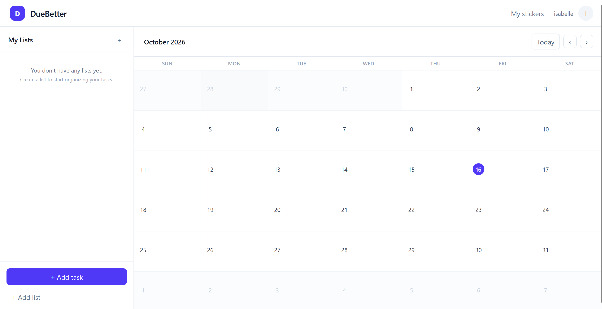

# DueBetter

DueBetter is a full-stack task and calendar application for organizing work into color-coded lists, planning tasks on a monthly calendar, and personalizing tasks with custom stickers.

**Live Demo:** [Open DueBetter](https://duebetter.vercel.app/)  
**Repository:** [GitHub](https://github.com/isabelle926/duebetter)

> **Note:** The API is hosted on Render's free tier and may require a short cold start after periods of inactivity.



## Overview

DueBetter combines a list-based task manager with a monthly calendar, allowing users to organize tasks by category while seeing how their workload is distributed over time.

Each user has an independent account with their own lists, tasks, sessions, and custom sticker library. Tasks can be scheduled on specific dates, grouped into color-coded lists, completed, edited, rescheduled, and viewed from a monthly calendar.

Custom stickers are uploaded through the FastAPI backend, validated server-side, and stored in Cloudflare R2. PostgreSQL stores the associated sticker metadata and task relationships.

DueBetter is deployed as a multi-service application with a React frontend on Vercel, a containerized FastAPI backend on Render, PostgreSQL hosted by Neon, and Cloudflare R2 for object storage.

## Features

- Account registration, login, and logout
- Server-side session authentication with HttpOnly cookies
- User-isolated lists, tasks, and stickers
- Color-coded task lists
- Monthly calendar view
- Day-specific task views
- Create, edit, complete, reschedule, and delete tasks
- Create, rename, recolor, and delete lists
- Custom PNG and WebP sticker uploads
- Sticker assignment to individual tasks
- Personal sticker library
- Server-side image validation
- Responsive interface
- Keyboard-accessible dialogs
- Persistent cloud-hosted data
- Rate limiting for authentication and uploads
- Automated backend and frontend tests
- Continuous integration with GitHub Actions

## Tech Stack

| Layer | Technologies |
| --- | --- |
| Frontend | React, TypeScript, Vite, React Router, TanStack Query, Tailwind CSS |
| Backend | Python, FastAPI, SQLAlchemy, Pydantic, Alembic |
| Database | PostgreSQL, Neon |
| Object Storage | Cloudflare R2 |
| Authentication | Server-side sessions, HttpOnly cookies |
| Testing | pytest, Vitest, React Testing Library |
| Infrastructure | Docker, Docker Compose, Vercel, Render |
| CI | GitHub Actions |
| Code Quality | oxlint |

## Architecture

```text
                              ┌──────────────┐
                              │     User     │
                              │   Browser    │
                              └──────┬───────┘
                                     │
                                     │ HTTPS
                                     ▼
                         ┌────────────────────────┐
                         │        Vercel          │
                         │                        │
                         │  React + TypeScript    │
                         │  Vite                  │
                         │  React Router          │
                         │  TanStack Query        │
                         └───────────┬────────────┘
                                     │
                                     │ REST API
                                     │ credentials: include
                                     ▼
                         ┌────────────────────────┐
                         │        Render          │
                         │                        │
                         │  Dockerized FastAPI    │
                         │  SQLAlchemy            │
                         │  Pydantic              │
                         │  Alembic               │
                         └───────┬────────┬───────┘
                                 │        │
                      SQL        │        │ S3-compatible API
                                 │        │
                                 ▼        ▼
                    ┌────────────────┐  ┌──────────────────┐
                    │      Neon      │  │  Cloudflare R2   │
                    │                │  │                  │
                    │  PostgreSQL    │  │  Sticker images  │
                    │                │  │                  │
                    │  Users         │  └──────────────────┘
                    │  Sessions      │
                    │  Lists         │
                    │  Tasks         │
                    │  Sticker       │
                    │  metadata      │
                    └────────────────┘


                         Development / CI

              ┌──────────────────────────────────┐
              │             GitHub               │
              │                                  │
              │  Source repository               │
              └────────────────┬─────────────────┘
                               │
                               │ push / pull request
                               ▼
              ┌──────────────────────────────────┐
              │         GitHub Actions           │
              │                                  │
              │  pytest                          │
              │  Vitest                          │
              │  React Testing Library           │
              │  oxlint                          │
              │  TypeScript / Vite build         │
              │  Docker image build              │
              └──────────────────────────────────┘
```

### Request Flow

A typical authenticated request follows this path:

```text
Browser
   │
   │ HTTPS request + HttpOnly session cookie
   ▼
Vercel frontend
   │
   │ REST API request
   ▼
FastAPI
   │
   ├── authenticate session
   ├── authorize resource ownership
   ├── validate request
   └── execute business logic
          │
          ▼
     PostgreSQL
          │
          ▼
       Response
```

Sticker uploads follow a separate storage path:

```text
Browser
   │
   │ multipart/form-data
   ▼
FastAPI
   │
   ├── authenticate user
   ├── apply rate limit
   ├── check sticker quota
   ├── validate file size
   ├── decode actual image
   ├── validate PNG/WebP format
   └── validate dimensions
          │
          ├──────────────► Cloudflare R2
          │                 image bytes
          │
          ▼
      PostgreSQL
      sticker metadata
```

## Engineering Highlights

### Authentication

DueBetter uses server-side session authentication rather than storing authentication tokens in browser-accessible JavaScript storage.

After successful registration or login, the backend generates a random session token and stores the corresponding session server-side. The browser receives the token through an HttpOnly cookie.

Production cookies use appropriate `Secure` and `SameSite` configuration for communication between the Vercel frontend and Render backend.

### Authorization

Authentication establishes who the user is; authorization determines which resources that user can access.

Protected database operations scope queries to the authenticated user's ID. A task lookup, for example, verifies both the task ID and its owner rather than trusting an ID supplied by the client.

This prevents one account from reading, updating, or deleting another user's lists, tasks, or stickers even if another resource UUID becomes known.

Backend integration tests explicitly exercise these cross-user authorization boundaries.

### Custom Sticker Uploads

Custom stickers are sent to FastAPI using `multipart/form-data`.

The backend treats file uploads as a security boundary and validates:

- Authentication and resource ownership
- Upload rate limits
- Per-user sticker quotas
- Maximum file size
- Actual decoded image format
- PNG/WebP allowlist
- Maximum image dimensions

Uploaded image bytes are stored in Cloudflare R2 under generated user-scoped object keys.

PostgreSQL stores only structured metadata such as ownership, image URL, object key, and task relationships.

### Database Design

PostgreSQL stores relational application data including:

```text
User
├── Sessions
├── Task Lists
│   └── Tasks
└── Stickers
```

Foreign keys maintain relationships between resources, while application-level authorization ensures resources remain isolated between users.

Database schema changes are managed through Alembic migrations.

Indexes support common task-query patterns such as retrieving tasks for a user and calendar date.

### Server State

TanStack Query manages server-owned frontend state including:

- Lists
- Tasks
- Stickers
- Loading states
- Error states
- Mutations
- Cache invalidation

Local React state is reserved for UI concerns such as form inputs, selected dates, and whether dialogs are open.

### Reliability

The backend exposes separate endpoints for liveness and readiness:

```text
GET /api/health
```

verifies that the FastAPI process is running.

```text
GET /api/ready
```

also checks database connectivity.

Docker and the production hosting environment can therefore distinguish between a running process and an application that is actually ready to handle database-backed requests.

### Security

DueBetter includes several production-hardening measures:

- HttpOnly session cookies
- Secure production cookies
- Explicit credentialed CORS origin
- Per-user authorization
- Authentication rate limiting
- Registration rate limiting
- Upload rate limiting
- Sticker upload quotas
- Image-content validation
- Security response headers
- Generic responses for unexpected server errors
- Server-side secret management
- No database or R2 credentials exposed to the frontend

## Testing

DueBetter includes automated backend and frontend testing.

### Backend

Backend integration tests use pytest and a dedicated PostgreSQL test database.

Coverage includes:

- Registration
- Login and logout
- Session authentication
- Duplicate email handling
- List CRUD
- Task CRUD
- Task completion
- Task filtering
- Cascade behavior
- Unauthenticated request rejection
- Cross-user read protection
- Cross-user update protection
- Cross-user delete protection
- Sticker uploads
- Invalid image rejection
- Sticker deletion
- Sticker authorization

External Cloudflare R2 operations are mocked during automated tests so the test suite does not modify production object storage.

Run the backend suite with:

```bash
cd backend
pytest
```

To generate a coverage report:

```bash
pytest --cov=app --cov-report=term-missing
```

### Frontend

Frontend tests use Vitest and React Testing Library.

Coverage includes:

- Calendar date generation
- Date formatting
- Task rendering
- Task completion interactions
- Task editing interactions
- Task deletion interactions
- Confirmation dialogs
- Day-specific task filtering
- Day-view interactions

Run the frontend tests with:

```bash
cd frontend
npm test
```

Run linting:

```bash
npm run lint
```

Build the production frontend:

```bash
npm run build
```

## Continuous Integration

GitHub Actions automatically validates changes pushed to the repository and pull requests targeting the main branch.

The CI pipeline runs three independent jobs:

```text
CI
│
├── Backend
│   ├── Start PostgreSQL service
│   ├── Install Python dependencies
│   ├── Run Alembic migrations
│   └── Run pytest
│
├── Frontend
│   ├── Install Node dependencies
│   ├── Run oxlint
│   ├── Run Vitest
│   └── Build production bundle
│
└── Docker
    └── Build FastAPI Docker image
```

Production Neon and Cloudflare credentials are not exposed to CI. Tests use temporary database infrastructure and mocked object-storage operations.

## Local Development

### Prerequisites

Install:

- Git
- Node.js
- Python 3.13+
- PostgreSQL
- Docker Desktop (optional)
- Cloudflare R2 credentials if testing sticker uploads

### Clone the Repository

```bash
git clone https://github.com/isabelle926/duebetter
cd duebetter
```

### Backend Setup

Navigate to the backend:

```bash
cd backend
```

Create a Python virtual environment:

```bash
python -m venv .venv
```

Activate it.

On macOS/Linux:

```bash
source .venv/bin/activate
```

On Windows PowerShell:

```powershell
.venv\Scripts\Activate.ps1
```

Install dependencies:

```bash
pip install -r requirements.txt
```

Create your environment file based on:

```text
backend/.env.example
```

Run database migrations:

```bash
alembic upgrade head
```

Start FastAPI:

```bash
uvicorn app.main:app --reload
```

The API runs at:

```text
http://localhost:8000
```

Interactive API documentation is available at:

```text
http://localhost:8000/docs
```

### Frontend Setup

From the repository root:

```bash
cd frontend
npm install
npm run dev
```

The frontend runs at:

```text
http://localhost:5173
```

## Docker

DueBetter includes Docker support for the backend and PostgreSQL development environment.

From the repository root:

```bash
docker compose up --build
```

Docker Compose starts:

```text
FastAPI
   │
   ▼
PostgreSQL
   │
   ▼
Persistent Docker volume
```

Database migrations run when the backend container starts.

Stop the environment with:

```bash
docker compose down
```

To intentionally remove the Docker PostgreSQL volume and its data:

```bash
docker compose down -v
```

## Environment Variables

### Backend

The backend uses the following environment variables:

```text
DATABASE_URL
FRONTEND_URL

SESSION_COOKIE_NAME
SESSION_LIFETIME_DAYS
SECURE_COOKIES
SESSION_COOKIE_SAMESITE

RATE_LIMIT_ENABLED

R2_ACCOUNT_ID
R2_ACCESS_KEY_ID
R2_SECRET_ACCESS_KEY
R2_BUCKET_NAME
R2_PUBLIC_URL
```

See:

```text
backend/.env.example
```

for development placeholders.

Never commit real database passwords, R2 credentials, or production secrets.

### Frontend

The frontend requires:

```text
VITE_API_URL
```

For local development this normally points to:

```text
http://localhost:8000/api
```

`VITE_API_URL` is a public configuration value. Database and Cloudflare credentials must never be exposed through `VITE_` variables.

## Deployment

DueBetter is deployed across several managed services:

```text
Vercel
└── React / TypeScript frontend

Render
└── Dockerized FastAPI backend

Neon
└── PostgreSQL

Cloudflare R2
└── Sticker image objects

GitHub Actions
└── Continuous integration
```

The Render backend runs Alembic migrations before starting FastAPI.

Because the API uses Render's free tier, it may spin down after periods of inactivity. The first API request after an idle period can therefore take longer while the service starts. Subsequent requests should respond normally.

## Project Structure

```text
duebetter/
│
├── .github/
│   └── workflows/
│       └── ci.yml
│
├── backend/
│   ├── alembic/
│   ├── app/
│   │   ├── api/
│   │   │   └── routes/
│   │   ├── core/
│   │   ├── db/
│   │   ├── middleware/
│   │   ├── models/
│   │   ├── schemas/
│   │   └── services/
│   │
│   ├── tests/
│   ├── Dockerfile
│   ├── start.sh
│   └── requirements.txt
│
├── frontend/
│   ├── src/
│   │   ├── api/
│   │   ├── components/
│   │   │   ├── calendar/
│   │   │   ├── layout/
│   │   │   ├── lists/
│   │   │   ├── stickers/
│   │   │   ├── tasks/
│   │   │   └── ui/
│   │   ├── hooks/
│   │   ├── pages/
│   │   ├── test/
│   │   └── types/
│   │
│   ├── package.json
│   └── vercel.json
│
├── docs/
│   └── images/
│       ├── dashboard.png
│
├── docker-compose.yml
└── README.md
```

## API Overview

DueBetter exposes REST endpoints for four primary areas:

```text
/api/auth
├── register
├── login
├── logout
└── me

/api/lists
├── create
├── read
├── update
└── delete

/api/tasks
├── create
├── read
├── filter
├── update
└── delete

/api/stickers
├── upload
├── list
└── delete
```

Interactive OpenAPI documentation is available from the FastAPI `/docs` endpoint.

## Future Improvements

DueBetter is intentionally scoped as a complete full-stack application rather than an indefinitely expanding feature project.

Potential future improvements include:

- Date-windowed or paginated task queries for large task histories
- Drag-and-drop list and task ordering
- Password reset and email verification
- End-to-end browser tests
- Dedicated production migration jobs
- Distributed rate limiting for multi-instance deployments
- Background retries for object-storage cleanup
- Custom frontend/API domains
- More comprehensive production observability and error tracking

## License

This project was built as a personal project.